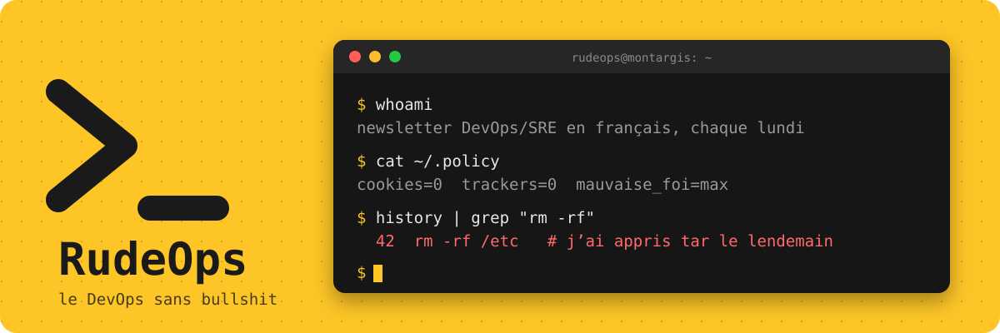

  <a href="https://www.rudeops.com"><b>S’abonner</b></a> ·
  <a href="https://www.rudeops.com/newsletters">Archives</a> ·
  <a href="https://www.rudeops.com/radar">Radar</a> ·
  <a href="https://www.rudeops.com/guides">Guides</a> ·
  <a href="https://www.rudeops.com/rudefinitions">Rudéfinitions</a> ·
  <a href="https://www.rudeops.com/feed.xml">RSS</a>

---

Je lis les changelogs, les post-mortems et les threads de 400 commentaires. Je garde ce qui compte, j’ajoute beaucoup de mauvaise foi, et ça part chaque lundi chez plus de 2000 personnes qui ont un vrai métier.

Pas de cookie. Pas de traceur. Pas de growth hacking. Juste de la veille, en français, par quelqu’un qui a un jour fait `rm -rf /etc` en prod et qui a appris `tar` dans la foulée.

## Ce qu’il y a sur rudeops.com

| | |
|---|---|
| 📬 **[La newsletter](https://www.rudeops.com/newsletters)** | Chaque lundi. La veille DevOps/SRE de la semaine, triée, commentée, rarement objective. |
| 📡 **[Radar](https://www.rudeops.com/radar)** | Les signaux du jour, pour ceux qui ne tiennent pas jusqu’à lundi. [RSS](https://www.rudeops.com/radar/feed.xml) |
| 📖 **[Guides](https://www.rudeops.com/guides)** | [Kubernetes](https://www.rudeops.com/guides/kubernetes), [Docker](https://www.rudeops.com/guides/docker), [Git](https://www.rudeops.com/guides/git), [SSH](https://www.rudeops.com/guides/ssh), [tmux](https://www.rudeops.com/guides/tmux), [jq](https://www.rudeops.com/guides/jq), [grep/awk/sed](https://www.rudeops.com/guides/grep-awk-sed), [systemd](https://www.rudeops.com/guides/systemd)… Ce que la doc officielle aurait dû dire. |
| 🎓 **[Certifications](https://www.rudeops.com/certifications)** | KCNA et KCSA, avec quiz. Pour réviser sans payer une formation hors de prix. |
| 📕 **[Rudéfinitions](https://www.rudeops.com/rudefinitions)** | Environ 300 définitions de la tech et du devops. Plus honnêtes que Wikipédia, moins que ton N+2. |
| 🧰 **[rudetools.dev](https://rudetools.dev)** | Les outils open source qui servent vraiment. |

## Ce qui traîne ici

<!-- Remplacer par le premier repo dès qu’il est poussé -->
Du code écrit le soir, entre deux numéros. Ça marche sur ma machine, et parfois à Montargis.

## Me trouver

Les avis exprimés ici n’engagent que moi, et encore, pas le lundi matin.
